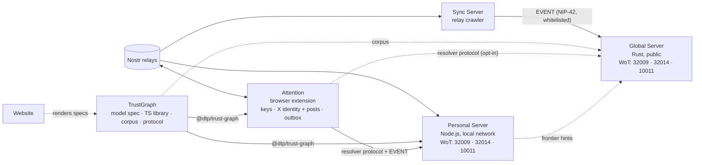

# TrustGraph

Shared Web-of-Trust model for the Digital Trust Protocol: one normative spec,
one TypeScript library, one conformance corpus, and one resolver protocol
(a NIP-01 WebSocket, identical on both servers).

Status: **library, corpus, and resolver protocol built** · 2026-10-01

## Why this exists

The Attention extension, the Personal Server, and the Global Server must give
the same answer to "is this identity worth my trust?" and "is this artifact
worth my time?". Two TypeScript runtimes share this library's code. The Rust
Global Server proves equality with the corpus.

Both servers speak the same protocol and hold only public Nostr events. X
identity and post data (accounts and posts the user has seen, Bio evidence)
stays in the extension.

## Specs

| Spec | What it defines |
| --- | --- |
| [specs/wot-model.md](specs/wot-model.md) | Normative model `dtp-wot/1`: records, context chains, the walk, results, product profile |
| [specs/identity-binding.md](specs/identity-binding.md) | X account ↔ npub binding per observer: witnesses, `10011` claims, **lenient vs strict** tables, hop rules |
| [specs/conformance.md](specs/conformance.md) | Corpus format, properties, fuzzing, and the known gaps in today's extension heap |
| [specs/library.md](specs/library.md) | Package split and the plan to extract `AttentionX/src/graph/trust` |
| [specs/resolver-api.md](specs/resolver-api.md) | Resolver protocol v1, identical on both servers: NIP-01 WebSocket with `DTP` resolver and lookup operations, NIP-42 auth, NIP-43 whitelist, ingest, guardrails |
| [specs/telemetry.md](specs/telemetry.md) | Admin telemetry pages on localhost, identical on both servers: pages, alerts, JSON, Prometheus metric names, privacy rules |

Protocol specs stay where they are today: `AttentionX/docs/NIP-32009.md`,
`NIP-32014.md`, `NIP-39.md`, `wot-questions.md`.

## Rules for implementers

- `@dtp/trust-graph` is locked, the same way `src/graph/trust` is in the
  extension. Changes need owner approval and corpus cases.
- There is one trust walk. Wrappers map results; they never re-implement it.
- The heap is runtime truth. No sidecar event lists beside the `Graph`.
- Results are subjective evidence for one root, never a global score.
- A server is an optimization, not an oracle: every result carries source
  event ids that anyone can verify against signed events.

## Open decisions

| ID | Decision |
| --- | --- |
| D1 | Home of the library: this new repo (`DigitalTrustProtocol/TrustGraph`) or the upstream `DigitalTrustProtocol/Trust` |
| D2 | npm scope (`@dtp/*` is a working name) |
| D6 | Name of the witness-only context for verifier services (`identity:attest` proposed) |

Decided (2026-10-01, [wot-model.md §9](specs/wot-model.md#9-product-profile-attention-scope-profile-xcom)):
**D3** gap fixes are approved in `@dtp/trust-graph` only (AttentionX
`src/graph/trust` is not updated); **D4** option A (a disconnected result has
no statements, `neutral = 0`, no `direct`); **D5** `lenient` is the default
binding mode on every runtime, `strict` on request.
